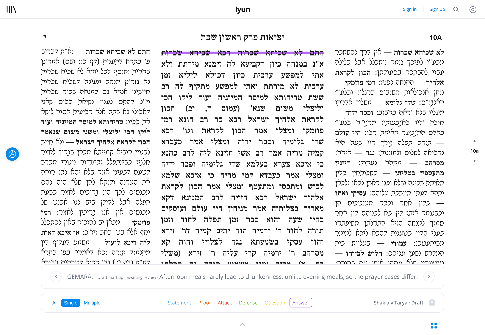

# Iyun · עיון

Iyun is a free, open-source Torah study site. It has Hebrew texts with openly licensed translations, classic commentary, the Vilna daf layout for all 37 Bavli tractates, notes, shared source sheets, and live chavruta study.

[GPL-3.0-or-later](LICENSE) · [orbitdodge.com](https://orbitdodge.com) · [Contributing](CONTRIBUTING.md) · [Credits and data licenses](NOTICE.md)

## What Iyun is

Iyun lets you open a text and study it. The library has about 2,000 books: Tanakh, Mishnah, Talmud, Midrash, halacha, Kabbalah, Chasidut and more. All of it is built from the open [Sefaria-Export](https://github.com/Sefaria/Sefaria-Export) dataset. Every title in the catalog either opens or says that it is unavailable. CI checks this.

The main reader shows the Vilna daf for every Bavli tractate, with Rashi and Tosafot around the Gemara. You also get search, bookmarks, notes, a commentary panel, cite-and-share links to a verse, a printable view, and a Hebrew or English interface. If you make an account, you can keep private chavruta groups, follow a partner's reading live, and publish source sheets. Sheets can be reported and moderated.

The pages are static HTML with vanilla JavaScript. The site installs as a PWA and works offline for what you have already read. After the build, the site makes no calls to Sefaria or any other third-party host. Texts, the calendar, and fonts all come from this project.

Every text shows its edition and license. Some editions are non-commercial. Those are flagged, so use the site as a tool for non-commercial study.

One thing to know about the markup. The Shakla v'Tarya markup (the argument structure of a page) was drafted with machine help. The reader labels it "Draft". No draft counts as reviewed until a person has checked it against the Hebrew and signed it off. Do not rely on it without checking. Most dapim have no markup yet.

Iyun is an independent project. It is not affiliated with any other study platform. It uses only openly licensed texts, translations, and fonts. See [NOTICE.md](NOTICE.md) for credits.

## Run it locally

You need Node 24 or newer. The server uses the built-in `node:sqlite` module.

    npm install        # only needed for deploys (wrangler)
    npm run build      # downloads the open texts and builds the library
    npm start          # same as: node server.js

Then open http://127.0.0.1:8000.

The build takes a few minutes and about 1 GB of disk. It writes `texts/` (not committed, because it is too large) and assembles `dist/`. Berakhot in the daf reader works without the build. The other tractates, the book reader, and the library need it.

The server stores accounts and groups in a SQLite file under `./data/`. Git ignores that folder. Before you start the server, you can set `HOST`, `PORT` and `IYUN_DATA_DIR`. The last name is an older one that we have not changed yet.

The AI answers in the study panel are optional. To turn them on, set `OPENAI_API_KEY` (and `OPENAI_MODEL`, if you like) before you start the server. No key ships with the code.

To try accounts, press Sign up, then sign in again from a second browser profile. Notes and bookmarks should sync within about eight seconds. Open Networks in the study drawer to make a group. Join it from the second account with the invite code.

If you open the pages with no backend at all (from `file://` or any static host), `cloud.js` checks `/api/status` once per browser session. When there is no server, the sign-in buttons are hidden, and the group panels explain that they need one.

Other scripts you may want from `package.json`: `npm run build:texts`, `build:dapim` and `build:calendar` run single build steps. `npm run meta` rewrites the shared page `<head>`. `npm run dev:worker` runs the Cloudflare Worker locally with wrangler.

## Tests

There is no single test command. These are the checks. CI runs all of them on every pull request and on every push to `main`.

- `npm run verify` checks that every catalog title opens a built text, resolves to a collection, or is marked unavailable. It never lands on a 404. To check a live host, add `-- --base=https://orbitdodge.com`.
- `npm run verify:annotations` validates every annotation file against the Hebrew text.
- `npm run meta:check` confirms that the shared `<head>` (Open Graph, Twitter, manifest) is the same on every page.
- `npm run test:api` tests accounts, public sheets, reports and moderation, groups, presence, live events, and account deletion. It runs against the Node server by default. To aim it at a Worker, pass `-- --base=http://localhost:8787 --admin-key=KEY`.
- `npm run test:a11y` runs axe-core on the main pages. Serious or critical issues fail the run.
- `npm run smoke` drives a real browser through the reader, daf, notes, sheets, chavruta, offline mode, and a mobile size. It needs Playwright and Chromium. Screenshots go to `.smoke/`.

Builds should be repeatable. The menu-name lookups live in `scripts/name-resolution.json`, and the calendar lives in `scripts/calendar-snapshot.json`. That way CI does not depend on Sefaria's live API. The API rate-limits CI runners, and once it quietly dropped hundreds of titles. A failed lookup now stops the build. To refresh the data, run `node scripts/build-texts.mjs --refresh-names` and `npm run build:calendar`. Then copy the new `texts/calendar.json` over the snapshot.

## Deploying to Cloudflare

The live site runs on Cloudflare. One Worker serves `/api/*` (a D1 database, plus one Durable Object per user for live events). It serves every other path from an R2 bucket. Files sit in R2 gzip-compressed and go out with `encodeBody: 'manual'`, so the edge does not compress them a second time. The config is in `wrangler.jsonc`, and the code is in `worker/index.js`. The resource names in `wrangler.jsonc` come from the live deployment. Change them for your own account.

We use R2 instead of Workers static assets. The asset-upload API was not usable from where we deployed, and R2 has no per-deploy file limit. Static assets work too if you prefer them. Swap the `r2_buckets` entry for an `assets` block and drop `serveStatic`.

To deploy from your own machine:

1. Run `npx wrangler login`, or set `CLOUDFLARE_API_TOKEN` and `CLOUDFLARE_ACCOUNT_ID`.
2. Run `npm run build`.
3. Run `npx wrangler deploy`. You only need this when `worker/index.js` or `wrangler.jsonc` changed.
4. Upload the site. The upload route stays closed until you set a secret. Run `npx wrangler secret put UPLOAD_KEY` and enter a long random value. Then run `SITE_URL=https://orbitdodge.com UPLOAD_KEY=<that value> npm run upload`. Only changed files are sent. Afterwards, close the route with `npx wrangler secret delete UPLOAD_KEY`.
5. On a brand new account, first run `npx wrangler d1 create <your-d1-name>` and put the id in `wrangler.jsonc`. Then run `npx wrangler d1 migrations apply <your-d1-name> --remote`, and `npx wrangler r2 bucket create <your-bucket-name>`. Use the names you set in `wrangler.jsonc`.

For the optional AI, run `npx wrangler secret put OPENAI_API_KEY`. For moderation, set the secret `ADMIN_KEY`. Then call `GET /api/admin/reports` with `Authorization: Bearer <key>`.

`.github/workflows/ci.yml` runs the checks above. `deploy.yml` builds the library, verifies it, deploys the Worker, uploads the site, and checks the live host. It needs the repository secrets `CLOUDFLARE_API_TOKEN` and `CLOUDFLARE_ACCOUNT_ID`. The text library is never committed, so each deploy rebuilds it and picks up new titles on its own.

Cloudflare may add its own Web Analytics beacon if you switch it on for your zone. That is not part of our code. The free tiers apply, and this build is about 300 MB compressed in R2. Presence on Workers is best-effort. A closed tab can look online until the next keep-alive.

## What is in the library

Of the 534 catalog entries, 413 open straight to a text (with English for 378 of them). 115 are collection pages whose volumes all resolve. One Rav Kook child, _Gray Matter IV_, has no text in the dataset. Six more have no counterpart in the open dataset, and the site says so: _Otzar Dinim La'Isha Ule'Bat_, _Hakdamah LaZohar_, _Taamei Hamikra_, _Yom-Tov Lipman Heller_, _Milot Higayon_ and _Maharam Shif_. We map 16 more menu names by hand to the dataset's differently spelled titles, and we checked each target. Bavli _Shekalim_ has no Bavli text in the dataset, so it opens the Yerushalmi tractate. The last verified build held 1,912 books, collection volumes included. The next build also adds Onkelos for the five Torah books.

For each book, Hebrew is the default Hebrew version, and its license appears with the text. English is picked from versions licensed Public Domain, CC0, CC-BY, CC-BY-SA, CC-BY-NC or CC-BY-NC-SA. The build takes the version that covers the most Hebrew, and open licenses win near-ties. Versions with unknown, missing, all-rights-reserved, or no-derivatives licenses are never used. Non-commercial versions are labeled "non-commercial use only", for example the William Davidson English for the Bavli.

In the last verified build, 902 of 1,912 books had English: 776 openly licensed and 126 non-commercial. 498 of those cover at least 80% of the Hebrew, and 369 cover under 30%. The Tur is one example. The dataset has only a few community-translated passages for it. The reader tells you how many lines in the current section have English. Many books have none, because the open dataset has no licensed translation of them. We will not fill that gap with machine translation and call it a translation.

The daf layout covers all 37 Bavli tractates. Rashi and Tosafot come from the Vilna edition. Where Rashi ends, the page uses Rashbam, labeled RASHBAM (Bava Batra from 29b). Tamid has no Rashi or Tosafot in the dataset. Berakhot (2a to 64a) is the most polished tractate, because we built its data by hand. The other 36 tractates, 5,224 dapim, are generated by `npm run build:dapim`.

On generated dapim, the English strip steps through the William Davidson English (CC-BY-NC) or the community translation, and it lights up matching words. The matching is approximate, because the English follows a different Hebrew edition than the Vilna text. Rashi and Tosafot English exists only where the dataset has translated them. For example, 323 of 8,729 Rashi comments on Shabbat have English. The strip also marks some argument cues at the start of English lines, when they line up well with the Hebrew: 13,240 cues on 4,130 pages. Literal Hebrew discourse formulas are detected on 4,839 of the 5,349 dapim. They are shown with dotted underlines, and tapping one shows its meaning. These cues mark only what the source supports. They are not a full argument map.

Known limits of the generator:

- The chapter opener and running head rely on Wikisource's markup, so Sanhedrin shows 10 chapters instead of 11.
- A second Mishnah partway down a daf appears inline in the Gemara text, not set apart.
- Berakhot-only features (the source English toggle and 2a phrase sync) are missing elsewhere.
- Some general books have complex Sefaria structures that the simple section navigator does not cover.

Other pieces: the daily links (Weekly Parasha and Today's Daf) read a static calendar built from Sefaria's public calendar data. It currently runs to 2027-06-07 for Daf Yomi and to June 2028 for the parasha. After those dates the shortcuts keep their default targets. `npm run build:calendar` picks up later dates once the source has them. The Bereishit sample page (`markup.html`) shows five verses with word marking and a structure map.

The study drawer has local tools: Markup, Punctuate, Flowcharts, Sync, Writer, TouchQuiz, Collections, Chavruta, Media, Live, Networks, and a text search called Golem. They save in your browser. Live follows a section between tabs, or between devices when you are signed in.

## Shakla v'Tarya markup and review

`annotations/berakhot.json` is the first per-tractate annotation file. There are more now. Each daf holds ordered word ranges. Each range has one of six argument roles, a short English explanation in our own words, and a checksum of the Hebrew. Each file also has a version and a status of `draft` or `reviewed`. Every daf is drafted in our own words from the Hebrew. All the drafts were produced with machine help and are unreviewed. The reader marks them with a Draft label, and it ignores any record whose checksum no longer matches the Hebrew.

The validator also rejects mechanically repeated fixed-width ranges. Full word coverage does not prove the structure is right, so someone who knows the text has to read each daf.

To review a daf, open [review.html](review.html). It lists every daf as reviewed, draft, or not yet drafted, and links into the reader. Check the daf against the Hebrew. Then download the sign-off file from that page. A maintainer applies it with `npm run annotations:signoff -- file.json`. The script refuses unless the daf is a draft whose Hebrew is unchanged. It records the reviewer and the date. A reviewed record must name its reviewer and a `reviewedAt` date in YYYY-MM-DD form. `npm run build:review-index` regenerates `annotations/index.json`, the data behind that page. The full build runs it for you.

Tools for working on drafts:

- `npm run annotations:worklist -- --tractate=Berakhot` prints a coverage summary. Add `--daf=13b` to export indexed words and translations for editing.
- `npm run annotations:cues` reports the English argument cues that line up with the displayed Hebrew.
- `node scripts/annotation-batch-data.mjs --tractate=Shabbat --start=0 --limit=5` exports a review batch with alignment scores and opening cues.
- `npm run annotations:draft -- --preview --all` shows the chunk plan for every missing daf. It does not call any model.
- `npm run annotations:draft -- --tractate=Berakhot --daf=13b` generates one machine-assisted candidate using `OPENAI_API_KEY`. Pass `--provider=cloudflare` to use Workers AI with `CLOUDFLARE_API_TOKEN` and `CLOUDFLARE_ACCOUNT_ID` instead. Use `--all --limit=10` for a bounded batch. Candidates are written under `.cache/annotation-candidates/`, outside the public reader.
- `npm run annotations:import -- path/to/candidate.json` brings a candidate in, but only after an editor has checked its labels, boundaries, and explanations.

You can also fix markup inside the reader, download that daf's draft from the Control Center, and import it with the same command. The instructions for drafting are in [annotations/DRAFTING_BRIEF.md](annotations/DRAFTING_BRIEF.md).

## What it does not do

Iyun has its own accounts, groups, live sync, and optional AI. It does not have per-school subdomains, a publishing platform, or institutional or student supervision. The closest thing is the owner and member roles on invite-code groups. That is not a school product.

## How to contribute

Read [CONTRIBUTING.md](CONTRIBUTING.md). In short: run `npm run verify`, `npm run verify:annotations`, `npm run meta:check`, and `npm run test:api` before you open a pull request. Reviewing annotations is the most useful thing a person with the right background can do. Add only texts, fonts, and images that carry an open license, and note the credit in [NOTICE.md](NOTICE.md). Please follow the [code of conduct](CODE_OF_CONDUCT.md). To report a security problem, see [SECURITY.md](SECURITY.md).

## License

The code is free software under the [GNU General Public License v3.0 or later](LICENSE). Texts, translations, fonts, and annotations are separate works with their own terms. They are listed in [NOTICE.md](NOTICE.md). The annotations are offered under CC BY-SA 4.0. The fonts are self-hosted under the SIL Open Font License: Open Sans, Frank Ruhl Libre, Noto Rashi Hebrew, and Assistant. Search uses the vendored [MiniSearch](https://github.com/lucaong/minisearch) (MIT).

## Sources and credit

- The Gemara Hebrew for all tractates is the Vilna Talmud (public domain), digitized on Hebrew Wikisource (CC BY-SA). Rashi, Rashbam, and Tosafot are the Vilna edition (public domain). All of it comes through the [Sefaria export](https://github.com/Sefaria/Sefaria-Export).
- Berakhot pages without hand-built English use A. Cohen's 1921 public-domain edition from the built text library.
- Rashi and Tosafot English comes from the Sefaria Community Translation (CC0) where it exists. The first Tosafot 2a translation, by Jan Buckler, is CC BY and is credited in the reader.
- Other books come from the open Sefaria-Export dataset at build time. The reader shows the version and license for each. Daily calendar data comes from Sefaria's public calendar API at build time.
- Directory titles come from a public study-platform menu and Sefaria's public table of contents. We use only the titles, nothing else. See NOTICE.md.
- The Bereishit sample has a short Hebrew text and word glosses in `data.js`.

Check any translation or markup against a trusted edition before you rely on it for learning.

## Where things live

| Files                                                                          | What they do                                                           |
| ------------------------------------------------------------------------------ | ---------------------------------------------------------------------- |
| index.html, site.css, site.js, catalog.js, catalog-directories.js              | Home page, app launcher, library, search                               |
| book.html, book.css, book.js, library.js                                       | General book reader and study tools (reads the local `texts/`)         |
| gemara.html, gemara.css, gemara.js, daf-loader.js, daf-data.js, study-tools.js | Daf reader for all Bavli tractates, and its study tools                |
| markup.html, styles.css, app.js, data.js                                       | Bereishit markup sample                                                |
| server.js, cloud.js                                                            | Accounts, sync, groups, live events, and optional AI (Node and SQLite) |
| worker/index.js, wrangler.jsonc, migrations/                                   | The same API on Cloudflare Workers, D1, and Durable Objects            |
| scripts/build-texts.mjs, build-dapim.mjs, build-calendar.mjs, build-site.mjs   | Build the library, calendar, and the deployable `dist/`                |
| cosmos.css, fonts/                                                             | The shared night-sky background and the self-hosted fonts              |

The repository is at https://github.com/Flipper1Zero/Iyun.
